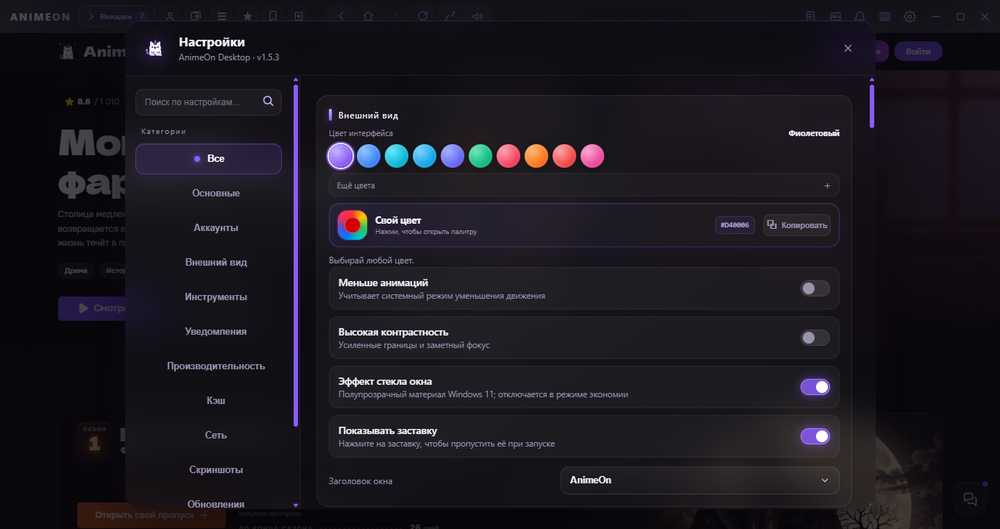

<div align="center">


# 🌸 AnimeOn Desktop

**Удобное десктопное приложение для просмотра аниме на [AnimeOn](https://animeon.cc/)**

[](../../releases)
[](../../releases)
[](#-системные-требования)
[](https://www.electronjs.org/)
[](LICENSE)

[📥 Скачать](../../releases) · [🛠️ Сборка](#️-сборка-из-исходников) · [🌐 Ссылки](#-ссылки) · [💬 Telegram](https://t.me/animeon)

</div>

---

## ✨ О проекте

**AnimeOn Desktop** — приложение для Windows, которое позволяет пользоваться сайтом [AnimeOn](https://animeon.cc/) прямо с компьютера, как обычной программой, а не вкладкой браузера.

Оно сделано для более комфортного просмотра аниме на ПК: с вкладками, горячими клавишами, оформлением под себя и удобными мелочами вокруг плеера.

<p align="center">
  
  <br />
  <sub>Главное окно</sub>
  <br /><br />
  
  <br />
  <sub>Настройки</sub>
</p>

## 🚀 Возможности

<table>
<tr>
<td width="50%" valign="top">

### 🎬 Просмотр
- 🔊 Громкость, перемотка и переключение серий горячими клавишами
- 📝 Заметки на нужной секунде видео
- 📸 Скриншоты окна в PNG
- ⏸️ Автопауза при блокировке экрана и сне

</td>
<td width="50%" valign="top">

### 🧩 Удобство
- 🗂️ Вкладки и несколько окон
- 👥 Несколько аккаунтов (отдельные сессии)
- ⌨️ Горячие клавиши
- ⚡ Палитра команд с быстрыми действиями
- 🔔 Системные уведомления и режим «Не беспокоить»
- 📌 Трей, поверх всех окон, автозапуск
- 🎮 Статус в Discord (Rich Presence)

</td>
</tr>
<tr>
<td width="50%" valign="top">

### 🎨 Оформление
- 🌈 Темы и свой цвет акцента
- 🎚️ Настройка css
- 🧪 Свой CSS для сайта
- 💾 Профили оформления

</td>
<td width="50%" valign="top">

### 🔒 Надёжность и безопасность
- 🔑 Ключ доступа (код или графический), хранится в зашифрованном виде
- 🌍 Зеркала сайта и проверка соединения
- 🛰️ Поддержка прокси
- 🔄 Безопасные обновления с проверкой целостности файла
- 🩺 Диагностика и журнал работы

</td>
</tr>
</table>

## 📥 Установка

Все готовые сборки находятся в разделе **[Releases](../../releases)**.

| Версия | Файл | Для кого |
| :-- | :-- | :-- |
| 📦 **Установщик** | `AnimeOn-Setup-<версия>.exe` | Для постоянного использования: ярлыки, автозапуск, выбор папки установки |
| ⚡ **Portable** | `AnimeOn-Portable-<версия>.exe` | Без установки: скачали и запустили |

### 📦 Установщик

1. Скачайте `AnimeOn-Setup-<версия>.exe` из [Releases](../../releases).
2. Запустите файл и следуйте подсказкам мастера установки.
3. Запустите **AnimeOn** с ярлыка на рабочем столе или из меню «Пуск».

### ⚡ Portable

1. Скачайте `AnimeOn-Portable-<версия>.exe` из [Releases](../../releases).
2. Запустите файл, установка не требуется.

> [!TIP]
> Portable-версия при каждом запуске распаковывается во временную папку, поэтому стартует чуть медленнее установленной. Для ежедневного использования лучше установщик.

## 🛠️ Сборка из исходников

Понадобятся **[Node.js](https://nodejs.org/)** и **npm**.

```bash
# 1. Клонировать репозиторий
git clone https://github.com/Neukluziy/animeon-desktop.git
cd animeon-desktop

# 2. Установить зависимости
npm install

# 3. Запустить приложение
npm start

# 4. Собрать установщик и portable-версию
npm run dist
```

После сборки готовые файлы появятся в папке `dist`:

- 📦 **NSIS Installer**: обычный установщик Windows;
- ⚡ **Portable**: версия, которая не требует установки.

> [!NOTE]
> Сборка предназначена для **Windows x64**.

## 💻 Системные требования

| | |
| :-- | :-- |
| **ОС** | Windows 10 / 11 |
| **Архитектура** | x64 |

## 🌐 Ссылки

| | |
| :-- | :-- |
| 🌸 **Основной сайт** | [animeon.cc](https://animeon.cc) |
| 🌐 **Для РФ** | [v2.animeon.co](https://v2.animeon.co) |
| 💬 **Telegram** | [t.me/animeon](https://t.me/animeon) |
| 👤 **Автор на AnimeOn** | [animeon.cc/user/dsizer](https://animeon.cc/user/dsizer) |

## ℹ️ Примечание

> [!IMPORTANT]
> AnimeOn Desktop **не является официальным клиентом** сайта AnimeOn. Приложение разработано отдельно для использования AnimeOn на Windows.

## 📄 Лицензия

Проект распространяется по лицензии **MIT**, подробности в файле [LICENSE](LICENSE).

---

<div align="center">

Сделано с 💜 [Neukluziy](https://github.com/Neukluziy)

</div>
